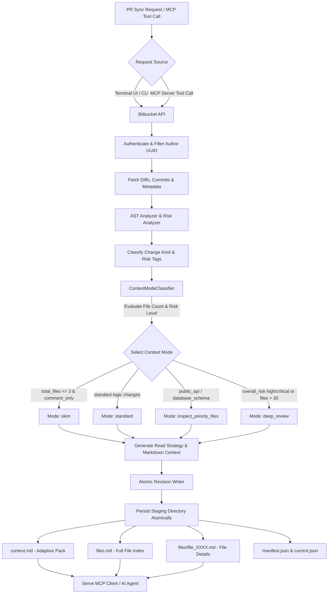

# 🚀 mcp-pr-companion

`mcp-pr-companion` is a local pre-processing system for Bitbucket Cloud REST API v2 designed to convert Pull Requests into compact, **Adaptive AI Context Packs** optimized for AI Coding Assistants and AI Agents.

---

## 📌 1. Features Overview

* **Adaptive AI Context Strategy**:
  - Dynamically tailors context pack structures based on PR size and risk level across 4 modes: `skim`, `standard`, `inspect_priority_files`, and `deep_review`.
  - Automatically generates an explicit **Read Strategy** section guiding AI agents on required next files, optional next files, and skipped categories to optimize token efficiency (**70% - 95% token savings**).
  - Moves full file lists into `files.md`, keeping `context.md` ultra-compact (0.5 – 1KB for comment-only PRs).
* **Schema v4 & Atomic Revision Storage**:
  - Multi-revision storage engine featuring atomic write staging to prevent partial writes.
  - Manages active revision pointers via `current.json` (`context_path`, `files_summary_path`, `actions_path`, `manifest_path`, `ai_reading_mode`).
* **MCP Server & Dual-Interface Architecture**:
  - **Local MCP Server over stdio**: Exposes MCP tools (`get_pr_context_pack`, `get_pr_file_context`, `search_pr_files`, `get_pr_manifest`, `get_pr_sync_status`, `refresh_pr_data`) for direct integration with AI IDEs and Agents.
  - **Terminal UI (`npm run cmd`)**: Authenticates with the API token from `.env`, then lets you view your open pull requests and generate context packs.
  - **One-Command Auto Sync (`npm run mcp-pr-companion`)**: Automated sequential discovery, filtering, and context pack generation for all OPEN pull requests owned by the user.
* **AST Analyzer & Secret Redacting Security**:
  - Classifies change kinds (`comment_only`, `functional_logic`, `public_api`, `database_schema`, `auth_security`, `configuration`, etc.).
  - Extracts source code AST symbols (functions, methods, HTTP routes).
  - Automatically scans and redacts tokens/passwords via `Redactor` (`ATBB****abcd`).
  - Enforces account identity locking (`author.uuid`) to prevent cross-account PR data leakage.

---

## 🛠️ 2. Setup & Run

### Quick start (any machine)

```bash
git clone <repo-url> && cd mcp-pr-companion
./run.sh cmd          # Linux / macOS
run.cmd cmd           # Windows
```

The first run prepares everything automatically and stops once to ask for configuration:

1. **Node.js**: `run.cmd` / `run.sh` install Node.js LTS if it is missing or older than 20.12 (Windows: `winget`; macOS: `brew`; Linux: NodeSource via `apt-get`/`dnf`/`yum`, needs `sudo`).
2. **Dependencies**: `bin/cli.js` runs `npm ci` whenever `package-lock.json` changes (needs access to the npm registry).
3. **Build**: rebuilds `dist/` whenever `src/` changes.
4. **Configuration**: creates `.env` from `.env.example` and lists the values to fill in. Fill them in and run the same command again.

If Node.js ≥ 20.12 is already installed you can skip the launcher and use `node bin/cli.js <command>` or the npm scripts below.

### Configuration (`.env`)

All settings, including credentials, come from environment variables. `.env` is git-ignored and docker-ignored; only the empty template `.env.example` is committed. Variables already set in the real environment (CI, Docker `--env-file`) take precedence over `.env`, and `.env` is then optional. Nothing is ever prompted for or written to disk.

| Variable | Required | Description |
|---|---|---|
| `BITBUCKET_EMAIL` | ✅ | Atlassian account email |
| `BITBUCKET_API_TOKEN` | ✅ | Bitbucket API token, read-only scopes: `read:user`, `read:pullrequest`, `read:repository` |
| `BITBUCKET_REPOSITORY` | ✅ for `cmd` / `generate-all` | `workspace/repo` (the MCP server takes the repository from each PR URL) |
| `ALLOWED_EMAILS` | | Comma-separated accounts allowed to run the tool (empty = any) |
| `TICKET_PREFIXES` | | Default `WCE-,PROJ-,JIRA-` |
| `PRIVACY_MODE`, `PRIVACY_REMOVE_AUTHOR`, `PRIVACY_FILE_PATH_MODE`, `PRIVACY_MAX_COMMIT_SUBJECTS` | | Output privacy settings (defaults in `.env.example`) |
| `AI_CONTEXT_ROOT`, `AI_CONTEXT_COMPANY`, `AI_CONTEXT_APP` | | Output location (default `ai-context/siliconstack/...`) |

### Commands

| Command | Description |
|---|---|
| `npm run cmd` (`node bin/cli.js cmd`) | **Terminal UI**: view open PRs, sync a PR, generate context packs. |
| `npm run mcp-pr-companion` (`node bin/cli.js generate-all`) | **One-command run**: discovers your open PRs and generates context packs, no interaction. |
| `npm start` (`node bin/cli.js server`) | **MCP server** over stdio for AI IDEs / agents. |
| `npm run healthcheck` (`node bin/cli.js check`) | Reports Node.js, dependencies, build and `.env` status without changing anything (exit 1 if not ready). |
| `npm run prepare-app` (`node bin/cli.js prepare`) | Installs dependencies and builds without starting anything (used by Docker/CI). |
| `npm run dev` | MCP server from TypeScript sources via `tsx` (developers; reads `.env`). |
| `npm run build` / `npm test` | Compile `src/` to `dist/` / run all test files in isolated temp directories. |

### MCP client configuration

Point your MCP client at the bootstrap so it always starts from a ready state:

```json
{ "mcpServers": { "mcp-pr-companion": { "command": "node", "args": ["/absolute/path/to/mcp-pr-companion/bin/cli.js"] } } }
```

### Docker

```bash
docker build -t mcp-pr-companion .
docker run --rm -i  --env-file .env -v "$PWD/ai-context:/app/ai-context" mcp-pr-companion                # MCP server (stdio)
docker run --rm -it --env-file .env -v "$PWD/ai-context:/app/ai-context" mcp-pr-companion cmd            # Terminal UI
docker run --rm     --env-file .env -v "$PWD/ai-context:/app/ai-context" mcp-pr-companion generate-all   # One-command run
```

Credentials are passed at run time with `--env-file` and are never baked into the image.

---

## 🔄 3. Feature Workflow

The diagram below illustrates the end-to-end pipeline from PR request to **Adaptive AI Context Pack** generation and MCP serving:



---

## 📁 Runtime Directory & Context Output Layout

Generated context packs are structured as follows:

```text
ai-context/{company}/{app}/{feature}/{repo}_{PR-ID}/
├── context.md          # Primary AI Entrypoint (Adaptive Markdown Context Pack)
├── files.md            # Complete Changed Files Index & Categorization Table
├── actions.md          # Tool Action Summary & Coverage Metadata
├── current.json        # Pointer to Active Revision & Reading Mode
├── manifest.json       # Structured Metadata Manifest (v4 Schema)
├── files/              # Per-file AI Detail Markdown Files
│   ├── file_0001.md
│   └── file_0002.md
└── revisions/          # Revision History Subdirectory
    └── rev_xxxx_yyyy/
```
