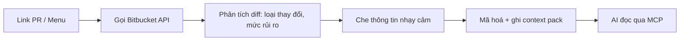

# mcp-pr-companion

Công cụ đọc Pull Request trên **Bitbucket Cloud** và biến nó thành một bộ tài liệu ngắn gọn (**context pack**) để AI (Claude, Copilot, Cursor…) đọc hiểu PR nhanh, tốn ít token.

Bạn có thể dùng theo 3 cách:

| Cách dùng | Lệnh | Khi nào dùng |
|---|---|---|
| **Menu trong terminal** | `.\run.cmd cmd` | Xem danh sách PR của bạn, chọn PR để tạo context |
| **Chạy 1 lệnh tự động** | `.\run.cmd generate-all` | Tạo context cho **tất cả** PR đang mở của bạn trong mọi repo khai báo, không cần thao tác |
| **MCP server** | `.\run.cmd` | Để AI trong IDE tự gọi lấy context PR (trực tiếp hoặc qua [mcp-hub](docs/HUB_INTEGRATION.md)) |

---

## 1. Bắt đầu nhanh (3 bước)

### Bước 1: Lấy code

```bash
git clone <repo-url>
cd mcp-pr-companion
```

### Bước 2: Chạy lần đầu

| Hệ điều hành | Lệnh |
|---|---|
| Windows (PowerShell) | `.\run.cmd check` |
| Windows (cmd) | `run.cmd check` |
| macOS / Linux | `./run.sh check` |

Lần chạy đầu, công cụ **tự chuẩn bị mọi thứ**, bạn không cần cài gì trước:

1. Chưa có Node.js (hoặc bản cũ hơn 20.12) → tự cài Node.js.
2. Chưa có thư viện → tự chạy `npm ci`.
3. Chưa build → tự build.
4. Chưa có file cấu hình → tự tạo file `.env` rồi **dừng lại** để bạn điền thông tin.

### Bước 3: Điền file `.env`

Mở file `.env` ở thư mục gốc và điền:

```ini
BITBUCKET_EMAIL=user@example.com
BITBUCKET_API_TOKEN=ATATT...
BITBUCKET_WORKSPACE=acme
BITBUCKET_REPOSITORY=api,web
```

`BITBUCKET_REPOSITORY` nhận **nhiều repo**, cách nhau bằng dấu phẩy. Repo nào không ghi workspace sẽ dùng `BITBUCKET_WORKSPACE`. Có thể ghi đầy đủ `workspace/repo` nếu repo nằm ở workspace khác, ví dụ `api,other-team/tool`.

Chạy lại `.\run.cmd check`. Thấy toàn dấu ✓ là xong:

```
✓ Node.js: Node.js 22.20.0 (requires >=20.12)
✓ Dependencies: dependencies match package-lock.json
✓ Build: dist/ is up to date
✓ Config (.env): required settings present
```

> **Cách tạo API token:** Bitbucket → *Personal settings* → *API tokens* → *Create API token with scopes*.
> Chỉ chọn 3 quyền **đọc**: `read:user:bitbucket`, `read:pullrequest:bitbucket`, `read:repository:bitbucket`.
> Không cấp quyền Write / Admin / Delete.

---

## 2. Sử dụng hằng ngày

```powershell
.\run.cmd cmd              # mở menu: xem PR, Sync 1 PR, Generate nhiều PR, xem dữ liệu đã giải mã
.\run.cmd generate-all     # tạo context cho tất cả PR đang mở của bạn, trong mọi repo khai báo
.\run.cmd check            # kiểm tra môi trường (không thay đổi gì)
.\run.cmd purge-plaintext  # xoá dữ liệu cũ chưa mã hoá trong ai-context/ (chạy 1 lần sau khi nâng cấp)
```

Đã có Node.js ≥ 20.12 thì có thể dùng lệnh npm, kết quả giống hệt:

| Lệnh npm | Tương đương |
|---|---|
| `npm run cmd` | `.\run.cmd cmd` |
| `npm run mcp-pr-companion` | `.\run.cmd generate-all` |
| `npm start` | `.\run.cmd` (MCP server) |
| `npm run healthcheck` | `.\run.cmd check` |

> Trong **PowerShell** phải gõ `.\run.cmd` (có `.\` ở đầu). Gõ `run.cmd` sẽ báo không tìm thấy lệnh.

### Kết quả nằm ở đâu?

```text
ai-context/[<AI_CONTEXT_COMPANY>/]<workspace>/<repo>/pr_<số PR>/
├── context.md      ← MỞ FILE NÀY TRƯỚC: tóm tắt PR + "Read next" (nên đọc file nào)
├── files.md        ← danh sách tất cả file thay đổi
├── files/          ← chi tiết từng file (file_0001.md, file_0002.md…)
├── manifest.json   ← dữ liệu dạng JSON
├── current.json    ← revision đang dùng
└── revisions/      ← 5 lần tạo gần nhất
```

Log: menu/generate-all ghi vào `Logs/<ngày>/`, MCP server ghi vào `Logs/mcp-server.log`.

---

## 3. Dùng với AI trong IDE (MCP server)

Thêm vào file cấu hình MCP của IDE (Claude Code, Cursor, VS Code…), sửa lại đường dẫn cho đúng máy bạn:

```json
{
  "mcpServers": {
    "mcp-pr-companion": {
      "command": "node",
      "args": ["<path-to>/mcp-pr-companion/bin/cli.js", "server"]
    }
  }
}
```

Sau đó chỉ cần đưa link PR cho AI, ví dụ: *"Tóm tắt PR https://bitbucket.org/<workspace>/<repo>/pull-requests/123"*.

Các tool AI có thể gọi (qua mcp-hub tên sẽ có tiền tố `pr__`, vd `pr__get_pr_context_pack`):

| Tool | Tác dụng |
|---|---|
| `get_pr_context_pack` | Lấy bản tóm tắt PR (`context.md`). **Luôn gọi cái này trước.** Tự tải PR từ Bitbucket nếu chưa có hoặc PR có commit mới; `refresh: true` để ép tải lại |
| `search_pr_files` | Tìm file theo đường dẫn, ngôn ngữ, trạng thái, loại thay đổi, mức rủi ro |
| `get_pr_file_context` | Xem chi tiết + diff của 1 file (vd `file_0001`), chia trang bằng `offset` / `max_chars` |
| `get_pr_file_changes` | Phân loại, rủi ro, symbol của 1 file dạng JSON (kèm 1 trang diff) |
| `get_pr_sync_status` | Xem PR đã có dữ liệu ở máy chưa (chỉ gọi Bitbucket để kiểm tra quyền đọc repo, không tải PR) |
| `get_pr_comments` | Đọc comment review của PR (cả comment inline, kèm `file_id`), đã che thông tin nhạy cảm; `include_resolved: false` để chỉ lấy thread chưa resolve |
| `list_my_open_prs` | Liệt kê PR đang mở của bạn (theo `BITBUCKET_REPOSITORY` hoặc 1 repo) kèm sẵn `pr_url` |
| `sync_my_open_prs` | Sync **toàn bộ PR đang mở của bạn** trong 1 repo (hoặc mọi repo trong `BITBUCKET_REPOSITORY`) rồi trả về danh sách PR: trạng thái, ticket, mức rủi ro. PR không có commit mới thì bỏ qua |
| `check_bitbucket_connection` | Kiểm tra email/token trong `.env` có kết nối được Bitbucket không |

Muốn dùng qua **mcp-hub** (một MCP gom nhiều MCP con): xem mục [Chạy dưới mcp-hub](#chạy-dưới-mcp-hub) bên dưới. Ví dụ sync cả repo qua hub:

```text
/mcp-hub:mcp-pr-companion <workspace>/<repo> sync toàn bộ PR về cho tôi
```

AI sẽ gọi `pr__sync_my_open_prs` rồi hiện bảng PR (PR, title, trạng thái, ticket, rủi ro). Muốn tự sync mỗi lần MCP khởi động thì đặt `AUTO_SYNC_ON_START=true` trong `.env`.

### Chạy dưới mcp-hub

1. Clone repo này **cạnh** `mcp-hub`, trong cùng thư mục cha: `<parent>/mcp-hub` và `<parent>/mcp-pr-companion`. Template của hub chạy `node bin/cli.js server` với `cwd` là `../mcp-pr-companion`.
2. Chạy `node bin/cli.js prepare` một lần (cài thư viện + build), để lần khởi động đầu trong hub không tốn thời gian cài đặt.
3. Thông tin đăng nhập vẫn nằm trong `.env` của repo này; hub không truyền secret nào.
4. Trong hub, tool có tên `pr__<tool>`, vd `pr__get_pr_context_pack`.

Chi tiết: [docs/HUB_INTEGRATION.md](docs/HUB_INTEGRATION.md) và contract phía hub `../mcp-hub/docs/mcps/mcp-pr-companion.md`.

---

## 4. Cấu hình (`.env`)

Mọi cấu hình nằm trong file `.env`. Danh sách đầy đủ có trong `.env.example`.

| Biến | Bắt buộc | Ý nghĩa |
|---|---|---|
| `BITBUCKET_EMAIL` | ✅ | Email tài khoản Atlassian |
| `BITBUCKET_API_TOKEN` | ✅ | API token (chỉ quyền đọc) |
| `BITBUCKET_REPOSITORY` | ✅ (với `cmd`, `generate-all`, `check`) | Danh sách repo, cách nhau bằng dấu phẩy: `api,web` hoặc `workspace/repo`. `generate-all` chạy **tất cả** repo; `cmd` cho chọn repo (và đổi repo trong menu). MCP server khởi động được khi để trống (tool nhận `pr_url` / `repository`), nhưng cần biến này cho `list_my_open_prs` / `sync_my_open_prs` khi không truyền `repository`, và cho `AUTO_SYNC_ON_START` |
| `BITBUCKET_WORKSPACE` | | Workspace mặc định cho các repo trong `BITBUCKET_REPOSITORY` không ghi workspace, vd `acme`. Không cần nếu mọi repo đã ghi `workspace/repo` |
| `ALLOWED_EMAILS` | | Chỉ cho phép các email này chạy tool (phân cách bằng dấu phẩy). Để trống = ai cũng chạy được |
| `AUTO_SYNC_ON_START` | | `true` = khi MCP server khởi động thì tự sync (chạy nền) mọi PR đang mở của bạn trong `BITBUCKET_REPOSITORY`. Mặc định `false` |
| `TICKET_PREFIXES` | | Tiền tố mã ticket ưu tiên, mặc định `WCE-,PROJ-,JIRA-`. Ngoài ra tool tự nhận mã dạng `KEY-123` trong tên branch hoặc `[KEY-123]` trong title |
| `PRIVACY_*` | | Mức ẩn thông tin trong kết quả (mặc định đã an toàn) |
| `AI_CONTEXT_ROOT` | | Thư mục lưu kết quả, mặc định `ai-context` |
| `AI_CONTEXT_COMPANY` | | Thêm 1 cấp thư mục (vd tên công ty) trước `<workspace>`. Để trống = không thêm |
| `DEBUG` | | `true` = ghi thêm log mức DEBUG vào `Logs/mcp-server.log`. Mặc định tắt |

### 🔒 Bảo mật

- `.env` **không bao giờ bị push lên git** (đã có trong `.gitignore`) và không bị đưa vào Docker image.
- Token chỉ nằm trong `.env` và bộ nhớ khi chạy. Công cụ không lưu token ra file nào khác, cũng không hỏi nhập token.
- Chỉ file mẫu `.env.example` (để trống) được commit.
- Token và mật khẩu lỡ nằm trong diff, cùng email trong tiêu đề, mô tả và commit message, được tự động che trước khi ghi ra kết quả.

### 🔐 Dữ liệu trong `ai-context/` được mã hoá

- **Mọi file** trong `ai-context/` đều được mã hoá (AES-256-GCM). Mở thư mục ra chỉ thấy một dòng header và dữ liệu nhị phân, không đọc được nội dung PR.
- Chỉ đọc được qua **MCP tool** hoặc **CLI** (`.\run.cmd cmd` → đăng nhập → **View synced PR context (decrypted)**), và chỉ sau khi kiểm tra kết nối Bitbucket thành công bằng `.env`: đúng email/token, qua `ALLOWED_EMAILS`, và account có quyền đọc repo đó. Không kết nối được thì không giải mã được, kể cả khi offline.
- Khoá lấy từ UUID của repo mà Bitbucket chỉ trả cho người có quyền đọc repo. Khoá chỉ nằm trong RAM, không lưu ra file.
- Tên thư mục và file (workspace, repo, số PR, `file_0001`…) vẫn để dạng thường.
- Dữ liệu tạo trước khi có mã hoá: chạy `.\run.cmd purge-plaintext` một lần để xoá, rồi sync lại.
- Chi tiết kỹ thuật và giới hạn: [docs/ENCRYPTION.md](docs/ENCRYPTION.md).

---

## 5. Chạy bằng Docker (tuỳ chọn)

Dùng khi muốn chạy giống hệt nhau trên mọi máy (QC, CI, server):

```bash
docker build -t mcp-pr-companion .

# Tạo context cho tất cả PR
docker run --rm --env-file .env -v "$PWD/ai-context:/app/ai-context" mcp-pr-companion generate-all

# Menu trong terminal
docker run --rm -it --env-file .env -v "$PWD/ai-context:/app/ai-context" mcp-pr-companion cmd

# MCP server
docker run --rm -i --env-file .env -v "$PWD/ai-context:/app/ai-context" mcp-pr-companion
```

---

## 6. Gặp lỗi?

Luôn chạy `.\run.cmd check` trước để xem thiếu gì.

| Thông báo | Cách xử lý |
|---|---|
| `Fill in BITBUCKET_... in .env` | Điền biến còn thiếu vào `.env` |
| `Email or API token invalid` | Sai email/token hoặc token hết hạn → tạo token mới, sửa `.env` |
| `Repository read access` ✗ | Sai `BITBUCKET_REPOSITORY` hoặc token thiếu quyền `read:repository` |
| `No access: this account cannot read <ws>/<repo>` | Account trong `.env` không có quyền đọc repo đó, nên dữ liệu đã mã hoá không mở được |
| `No access: cannot connect to Bitbucket` | Mất mạng: dữ liệu mã hoá chỉ mở được khi kiểm tra Bitbucket thành công |
| `Unencrypted ai-context file` | Dữ liệu cũ chưa mã hoá: chạy `purge-plaintext` hoặc sync lại PR |
| `npm ci failed` | Máy không vào được npm registry → kiểm tra mạng/proxy |
| `Node.js ... requires >=20.12` | Chạy bằng `.\run.cmd` / `./run.sh` để tự cài Node, hoặc cài từ https://nodejs.org |
| `'run.cmd' is not recognized` | Trong PowerShell phải gõ `.\run.cmd` |
| Linux báo cần `sudo` | Việc tự cài Node cần quyền admin; nhập mật khẩu khi được hỏi |

---

## 7. Cách hoạt động (tóm tắt)



- PR nhỏ (ví dụ chỉ sửa comment) được tóm tắt rất ngắn. PR lớn hoặc rủi ro cao (API, database, bảo mật) được đánh dấu file nào cần đọc kỹ.
- Ghi dữ liệu theo kiểu "an toàn": lỗi giữa chừng không làm hỏng dữ liệu cũ.

---

## 8. Dành cho developer

```bash
npm run dev      # chạy MCP server từ source TypeScript (đọc .env)
npm run build    # build src/ → dist/
npm test         # chạy toàn bộ test (trong thư mục tạm, không đụng dữ liệu thật)
```

- `run.cmd` / `run.sh`: kiểm tra và tự cài Node.js.
- `bin/cli.js`: kiểm tra thư viện, build và `.env`, sau đó khởi động app.
- `src/`: mã nguồn. `tests/`: test.

Tài liệu cho developer và AI agent (tiếng Anh):

| File | Nội dung |
|---|---|
| [AGENTS.md](AGENTS.md) | **Quy tắc bắt buộc** cho AI agent sửa repo này: invariant, code map, tool reference, definition of done |
| [docs/ARCHITECTURE.md](docs/ARCHITECTURE.md) | Pipeline, cấu trúc thư mục kết quả, ghi atomic, kiểm tra PR mới |
| [docs/STANDARDS.md](docs/STANDARDS.md) | Chuẩn code, contract của tool, contract bảo mật dữ liệu |
| [docs/DEPENDENCIES.md](docs/DEPENDENCIES.md) | Vì sao dùng từng thư viện, thư viện nào cố ý không dùng |
| [docs/HUB_INTEGRATION.md](docs/HUB_INTEGRATION.md) | Chạy như MCP con của mcp-hub |
| [docs/ENCRYPTION.md](docs/ENCRYPTION.md) | Mã hoá ai-context: định dạng file, nguồn khoá, cổng kiểm tra quyền, giới hạn, cách chuyển dữ liệu cũ |
