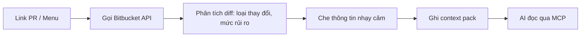

# mcp-pr-companion

Công cụ đọc Pull Request trên **Bitbucket Cloud** và biến nó thành một bộ tài liệu ngắn gọn (**context pack**) để AI (Claude, Copilot, Cursor…) đọc hiểu PR nhanh, tốn ít token.

Bạn có thể dùng theo 3 cách:

| Cách dùng | Lệnh | Khi nào dùng |
|---|---|---|
| **Menu trong terminal** | `.\run.cmd cmd` | Xem danh sách PR của bạn, chọn PR để tạo context |
| **Chạy 1 lệnh tự động** | `.\run.cmd generate-all` | Tạo context cho **tất cả** PR đang mở của bạn, không cần thao tác |
| **MCP server** | `.\run.cmd` | Để AI trong IDE tự gọi lấy context PR |

---

## 1. Bắt đầu nhanh (3 bước)

### Bước 1: Lấy code

```bash
git clone <repo-url>
cd mcp-pr-companion
```

### Bước 2: Chạy lần đầu

| Hệ điều hành | Lệnh |
|---|---|
| Windows (PowerShell) | `.\run.cmd check` |
| Windows (cmd) | `run.cmd check` |
| macOS / Linux | `./run.sh check` |

Lần chạy đầu, công cụ **tự chuẩn bị mọi thứ**, bạn không cần cài gì trước:

1. Chưa có Node.js (hoặc bản cũ hơn 20.12) → tự cài Node.js.
2. Chưa có thư viện → tự chạy `npm ci`.
3. Chưa build → tự build.
4. Chưa có file cấu hình → tự tạo file `.env` rồi **dừng lại** để bạn điền thông tin.

### Bước 3: Điền file `.env`

Mở file `.env` ở thư mục gốc và điền 3 dòng:

```ini
BITBUCKET_EMAIL=ten.ban@siliconstack.com.au
BITBUCKET_API_TOKEN=ATATT...
BITBUCKET_REPOSITORY=siliconstack/wec.be
```

Chạy lại `.\run.cmd check`. Thấy toàn dấu ✓ là xong:

```
✓ Node.js: Node.js 22.20.0 (requires >=20.12)
✓ Dependencies: dependencies match package-lock.json
✓ Build: dist/ is up to date
✓ Config (.env): required settings present
```

> **Cách tạo API token:** Bitbucket → *Personal settings* → *API tokens* → *Create API token with scopes*.
> Chỉ chọn 3 quyền **đọc**: `read:user:bitbucket`, `read:pullrequest:bitbucket`, `read:repository:bitbucket`.
> Không cấp quyền Write / Admin / Delete.

---

## 2. Sử dụng hằng ngày

```powershell
.\run.cmd cmd            # mở menu: xem PR, Sync 1 PR, Generate nhiều PR
.\run.cmd generate-all   # tạo context cho tất cả PR đang mở của bạn
.\run.cmd check          # kiểm tra môi trường (không thay đổi gì)
```

Đã có Node.js ≥ 20.12 thì có thể dùng lệnh npm, kết quả giống hệt:

| Lệnh npm | Tương đương |
|---|---|
| `npm run cmd` | `.\run.cmd cmd` |
| `npm run mcp-pr-companion` | `.\run.cmd generate-all` |
| `npm start` | `.\run.cmd` (MCP server) |
| `npm run healthcheck` | `.\run.cmd check` |

> Trong **PowerShell** phải gõ `.\run.cmd` (có `.\` ở đầu). Gõ `run.cmd` sẽ báo không tìm thấy lệnh.

### Kết quả nằm ở đâu?

```text
ai-context/siliconstack/<workspace>/<repo>/pr_<số PR>/
├── context.md      ← MỞ FILE NÀY TRƯỚC: tóm tắt PR + gợi ý nên đọc file nào
├── files.md        ← danh sách tất cả file thay đổi
├── files/          ← chi tiết từng file (file_0001.md, file_0002.md…)
├── manifest.json   ← dữ liệu dạng JSON
└── revisions/      ← lịch sử các lần tạo
```

Log chạy nằm trong `Logs/<ngày>/`.

---

## 3. Dùng với AI trong IDE (MCP server)

Thêm vào file cấu hình MCP của IDE (Claude Code, Cursor, VS Code…), sửa lại đường dẫn cho đúng máy bạn:

```json
{
  "mcpServers": {
    "mcp-pr-companion": {
      "command": "node",
      "args": ["D:/Visual Studio Code/mcp-pr-companion/bin/cli.js"]
    }
  }
}
```

Sau đó chỉ cần đưa link PR cho AI, ví dụ: *"Tóm tắt PR https://bitbucket.org/siliconstack/wec.be/pull-requests/4565"*.

Các tool AI có thể gọi:

| Tool | Tác dụng |
|---|---|
| `get_pr_context_pack` | Lấy bản tóm tắt PR (`context.md`). **Dùng cái này trước** |
| `get_pr_file_context` | Xem chi tiết 1 file thay đổi (vd `file_0001`) |
| `get_pr_file_changes` | Lấy diff của 1 file |
| `search_pr_files` | Tìm file theo đường dẫn, ngôn ngữ, mức rủi ro… |
| `get_pr_manifest` | Lấy dữ liệu PR dạng JSON |
| `get_pr_sync_status` | Xem PR đã có dữ liệu chưa |
| `refresh_pr_data` | Tải lại PR mới nhất từ Bitbucket |

---

## 4. Cấu hình (`.env`)

Mọi cấu hình nằm trong file `.env`. Danh sách đầy đủ có trong `.env.example`.

| Biến | Bắt buộc | Ý nghĩa |
|---|---|---|
| `BITBUCKET_EMAIL` | ✅ | Email tài khoản Atlassian |
| `BITBUCKET_API_TOKEN` | ✅ | API token (chỉ quyền đọc) |
| `BITBUCKET_REPOSITORY` | ✅ (với `cmd`, `generate-all`) | Repo dạng `workspace/repo`. MCP server không cần vì lấy repo từ link PR |
| `ALLOWED_EMAILS` | | Chỉ cho phép các email này chạy tool (phân cách bằng dấu phẩy). Để trống = ai cũng chạy được |
| `TICKET_PREFIXES` | | Tiền tố mã ticket, mặc định `WCE-,PROJ-,JIRA-` |
| `PRIVACY_*` | | Mức ẩn thông tin trong kết quả (mặc định đã an toàn) |
| `AI_CONTEXT_ROOT` | | Thư mục lưu kết quả, mặc định `ai-context` |

### 🔒 Bảo mật

- `.env` **không bao giờ bị push lên git** (đã có trong `.gitignore`) và không bị đưa vào Docker image.
- Token chỉ nằm trong `.env` và bộ nhớ khi chạy. Công cụ không lưu token ra file nào khác, cũng không hỏi nhập token.
- Chỉ file mẫu `.env.example` (để trống) được commit.
- Token và mật khẩu lỡ nằm trong diff, cùng email trong tiêu đề, mô tả và commit message, được tự động che trước khi ghi ra kết quả.

---

## 5. Chạy bằng Docker (tuỳ chọn)

Dùng khi muốn chạy giống hệt nhau trên mọi máy (QC, CI, server):

```bash
docker build -t mcp-pr-companion .

# Tạo context cho tất cả PR
docker run --rm --env-file .env -v "$PWD/ai-context:/app/ai-context" mcp-pr-companion generate-all

# Menu trong terminal
docker run --rm -it --env-file .env -v "$PWD/ai-context:/app/ai-context" mcp-pr-companion cmd

# MCP server
docker run --rm -i --env-file .env -v "$PWD/ai-context:/app/ai-context" mcp-pr-companion
```

---

## 6. Gặp lỗi?

Luôn chạy `.\run.cmd check` trước để xem thiếu gì.

| Thông báo | Cách xử lý |
|---|---|
| `Fill in BITBUCKET_... in .env` | Điền biến còn thiếu vào `.env` |
| `Email or API token invalid` | Sai email/token hoặc token hết hạn → tạo token mới, sửa `.env` |
| `Repository read access` ✗ | Sai `BITBUCKET_REPOSITORY` hoặc token thiếu quyền `read:repository` |
| `npm ci failed` | Máy không vào được npm registry → kiểm tra mạng/proxy |
| `Node.js ... requires >=20.12` | Chạy bằng `.\run.cmd` / `./run.sh` để tự cài Node, hoặc cài từ https://nodejs.org |
| `'run.cmd' is not recognized` | Trong PowerShell phải gõ `.\run.cmd` |
| Linux báo cần `sudo` | Việc tự cài Node cần quyền admin; nhập mật khẩu khi được hỏi |

---

## 7. Cách hoạt động (tóm tắt)



- PR nhỏ (ví dụ chỉ sửa comment) được tóm tắt rất ngắn. PR lớn hoặc rủi ro cao (API, database, bảo mật) được đánh dấu file nào cần đọc kỹ.
- Ghi dữ liệu theo kiểu "an toàn": lỗi giữa chừng không làm hỏng dữ liệu cũ.

---

## 8. Dành cho developer

```bash
npm run dev      # chạy MCP server từ source TypeScript (đọc .env)
npm run build    # build src/ → dist/
npm test         # chạy toàn bộ test (trong thư mục tạm, không đụng dữ liệu thật)
```

- `run.cmd` / `run.sh`: kiểm tra và tự cài Node.js.
- `bin/cli.js`: kiểm tra thư viện, build và `.env`, sau đó khởi động app.
- `src/`: mã nguồn. `tests/`: test.
