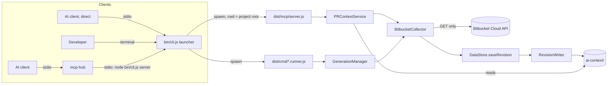
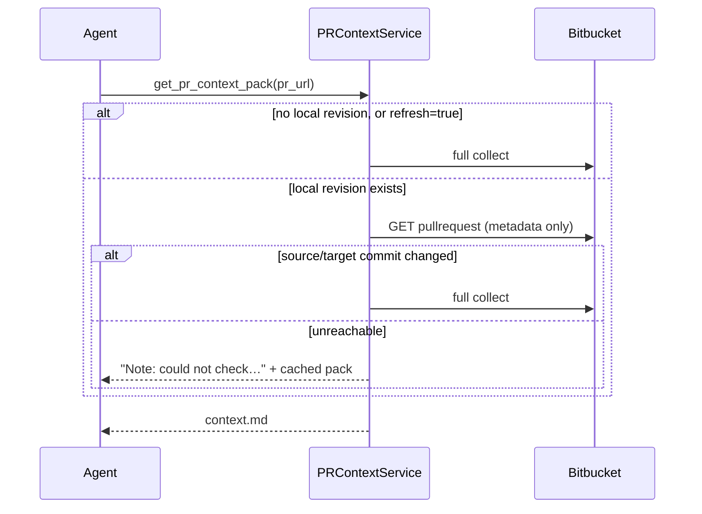

# Architecture

## 1. Topology



The MCP server and the CLI share one pipeline and one on-disk store. Neither keeps PR data in memory between calls.

## 2. Pipeline: Bitbucket → context pack

| Step | Code | What happens |
|---|---|---|
| 1. Collect | `BitbucketCollector.collect` | Metadata first (it fails hard if this fails), then commits, diffstat and raw diff in parallel. Partial failures become `coverage` entries and `warnings`, not exceptions. |
| 2. Project | `BitbucketAllowlistProjector` | Keeps only the allowlisted fields. The author is dropped when `PRIVACY_REMOVE_AUTHOR`; commit subjects are capped by `PRIVACY_MAX_COMMIT_SUBJECTS`. |
| 3. Sanitize | `PIISanitizer`, `SecretScanner`, `PathSanitizer` | Emails and account UUIDs in title, description and commits. Secrets in all text and every patch. Paths per `PRIVACY_FILE_PATH_MODE`, including diff header lines. |
| 4. Analyze | `DiffParser` → `ChangeClassifier` → `RiskAnalyzer` → `SymbolExtractor` | Per file: change kind, risk level/tags/evidence, touched symbols (regex heuristics, not an AST): C# members of any access level, SQL objects, and the enclosing scope git writes after `@@`. SQL tables/indexes/constraints are `database_schema` (high); views/procedures/functions/triggers are `database_object` (medium). |
| 5. Summarize | `DataStore.saveRevision` | Manifest (change and risk summary, ticket id from `TICKET_PREFIXES`), file index, per-file `change.json` and `patch.diff`, coverage. The PR's risk level is the highest file level; `risk_summary.reasons` names the files behind each tag. `stats.commits_count` is every commit; `commits.jsonl` keeps the newest `PRIVACY_MAX_COMMIT_SUBJECTS` non-merge ones. |
| 6. Read Strategy | `ContextModeClassifier` | Picks `skim` / `standard` / `inspect_priority_files` / `deep_review` and a token budget. Files are ranked by `ContextModeClassifier.score` (change size capped at 200, risk tags, new logic); `public_api` / `auth_security` / `database_schema` files are always in Read next; tests, renames, docs and formatting go to `low_priority` by id. `files.md` uses the same order. |
| 7. Persist | `RevisionWriter.writeRevision` | See §4. |

## 3. On-disk layout (frozen: AGENTS.md invariant 7)

```text
ai-context/[<AI_CONTEXT_COMPANY>/]<workspace>/<repo>/pr_<id>/
├── current.json            ← active revision pointer (written last)
├── context.md              ← what get_pr_context_pack returns
├── files.md                ← table of every changed file (include_file_table)
├── actions.md              ← coverage per section
├── manifest.json           ← copy of the active manifest (backward compatibility)
├── files/file_NNNN.md      ← what get_pr_file_context returns
└── revisions/rev_<src7>_<dst7>/
    ├── manifest.json
    ├── files.index.jsonl   ← what search_pr_files filters
    ├── commits.jsonl
    ├── coverage.json
    └── files/file_NNNN/{change.json, patch.diff}   ← get_pr_file_changes
```

Other local state, all git-ignored: `Logs/mcp-server.log` (MCP and launcher log), `Logs/<date>/*.jsonl` (CLI run logs), `.mcp-pr-companion/prs/salt.key` (salt for the opaque repo ids in CLI logs).

`OutputReader.getPROutputDir` also finds older folders written without a company segment or under the default root.

## 4. Write path and atomicity

Every file below is written with `writeSecure` and read with `readSecure` (`src/core/storage/secure-file.ts`): AES-256-GCM with a key derived from the repository UUID, released only by `AccessGate.unlock()` after a live Bitbucket check. Names stay plaintext, content never does. Details: [ENCRYPTION.md](ENCRYPTION.md).


1. Write the revision into `revisions/.tmp-<rev>-<ts>/`.
2. `RevisionValidator.validateOrThrow`: zod schemas plus cross-checks such as index totals against the manifest. On failure the temp folder is deleted and the active revision is untouched.
3. Rename it into `revisions/<rev>/`.
4. Rebuild `files/` aside, then swap it in, so ids from an older, larger revision never linger.
5. Write `context.md`, `files.md`, `actions.md` and the top-level `manifest.json` (each encrypted, temp file, fsync, rename).
6. Write **`current.json` last**. It is the commit point.
7. Prune: keep the active revision and the 4 newest others (`RevisionWriter.KEEP_REVISIONS = 5`).

A crash before step 6 leaves the previous `current.json` in place. Steps 4–5 may already show the new pack while `current.json` still names the old revision. The next sync repairs that.

## 5. Freshness and concurrency (MCP)



- `PRContextService.sync` keeps one in-flight promise per PR, so parallel calls (refresh or not) share a fetch.
- File tools never download PR data. Like every tool, they first pass the repository access check (`AccessGate.unlock`: one Bitbucket request per repository, cached 60 s), then read the revision that `get_pr_context_pack` or `sync_my_open_prs` last made current.
- `get_pr_comments` and `list_my_open_prs` always fetch live and store nothing: comments change without new commits, so a commit-hash freshness check cannot cover them. For the same reason `get_pr_context_pack` appends `## Review status (live)` (approval counts from the metadata it already fetched, latest build status per pipeline key) and `## Review threads (live)` at read time instead of storing them in `context.md`. Neither carries a person's name; comments only say whether the account is a Bitbucket app.
- Re-review: when a sync replaces a *different* revision, `DataStore.saveRevision` compares the files against the active revision (by sanitized path and patch content) and stores `changes_since_previous` in the manifest. `context.md` renders it as "Changed since last sync".
- Transient errors (429/502/503/504) are retried up to twice inside `fetchWithRetry`.
- Missing credentials or an `ALLOWED_EMAILS` denial fail the call, even when cached data exists.

## 6. Process model

- `bin/cli.js` is the only supported entry. It keeps `node_modules` and `dist/` in sync with the lockfile and `src/` (via stamps), loads `.env` (real env vars win), checks the required keys, and spawns the entry with `cwd` = project root.
- Under mcp-hub the child's stderr is discarded. The launcher and `Logger` therefore also append to `Logs/mcp-server.log`.
- The first start on a fresh clone runs `npm ci` and `tsc`, which can take a minute. Run `node bin/cli.js prepare` once before connecting a client.
- With `AUTO_SYNC_ON_START=true`, the server starts `PRContextService.autoSync()` in the background right after the stdio connection is up. It runs the same code as `sync_my_open_prs` over every `BITBUCKET_REPOSITORY` entry, never blocks tool calls (overlapping PR syncs share one fetch), and logs `auto_sync done total=… synced=… unchanged=… failed=…`. mcp-hub starts children per client session, so this runs once per session.
- Batch sync (`sync_my_open_prs`, auto-sync) runs 3 PRs at a time (`p-limit`). An unchanged PR costs one metadata request, and one failing PR is reported in its row without stopping the batch.
