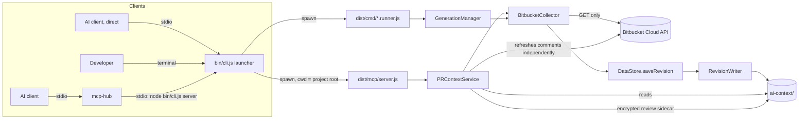

# Architecture

## 1. Topology



The MCP server and the CLI share one pipeline and one on-disk store. Neither keeps PR data in memory between calls.

## 2. Pipeline: Bitbucket → context pack

| Step | Code | What happens |
|---|---|---|
| 1. Collect | `BitbucketCollector.collect` | Metadata first (it fails hard if this fails), then commits, diffstat and raw diff in parallel. Partial failures become `coverage` entries and `warnings`, not exceptions. |
| 2. Project | `BitbucketAllowlistProjector` | Keeps only allowlisted fields. The author is dropped when `PRIVACY_REMOVE_AUTHOR`; commit subjects are capped by `PRIVACY_MAX_COMMIT_SUBJECTS`. Deleted diffstat entries map to `removed`; merge conflicts get a high-risk tag. |
| 3. Sanitize | `PIISanitizer`, `SecretScanner`, `PathSanitizer` | Emails and account UUIDs in titles, descriptions, commits, and branch names. Secrets in text, patches, and symbols. Paths per `PRIVACY_FILE_PATH_MODE`, including diff headers. |
| 4. Analyze | `DiffParser` → `ChangeClassifier` → `RiskAnalyzer` → `SymbolExtractor` | Per file: change kind, risk level/tags/evidence, and touched symbols (regex heuristics, not an AST). SQL schema changes and public/authentication files receive stronger review priority. |
| 5. Summarize | `DataStore.saveRevision` | Manifest (change and risk summary, ticket id from `TICKET_PREFIXES`), file index, per-file `change.json` and `patch.diff`, coverage. PR risk is the highest file risk; commit count covers all commits while stored subjects are capped and merge commits omitted. |
| 6. Read Strategy | `ContextModeClassifier` | Picks `skim` / `standard` / `inspect_priority_files` / `deep_review`; ranks files, prioritizes public API, auth/security, and database schema changes, and returns a token budget. |
| 7. Persist | `RevisionWriter.writeRevision` | See §4. |

## 3. On-disk layout (frozen: AGENTS.md invariant 7)

```text
ai-context/[<AI_CONTEXT_COMPANY>/]<workspace>/<repo>/<open|draft|merged|declined>/pr_<id>/
├── current.json            ← active revision pointer (written last; freshness_checked_at stamped in place)
├── context.md              ← what get_pr_context_pack returns
├── files.md                ← table of every changed file (include_file_table)
├── actions.md              ← coverage per section
├── manifest.json           ← copy of the active manifest (backward compatibility)
├── files/file_NNNN.md      ← what get_pr_file_context returns
├── live-review/
│   ├── current.json        ← pointer to the last complete review snapshot
│   ├── last-attempt.json   ← encrypted refresh outcome and sanitized warnings
│   └── snapshots/<id>/
│       ├── index.json      ← versioned metadata, completeness and warnings
│       └── comments.jsonl  ← full sanitized comments, one per line
└── revisions/rev_<src7>_<dst7>/
    ├── manifest.json
    ├── files.index.jsonl   ← what search_pr_files filters
    ├── commits.jsonl
    ├── coverage.json
    └── files/file_NNNN/{change.json, patch.diff}   ← get_pr_file_changes
```

Other local state, all git-ignored: `Logs/mcp-server.log` (MCP and launcher log), `Logs/<date>/*.jsonl` (CLI run logs), `.mcp-pr-companion/prs/salt.key` (salt for the opaque repo ids in CLI logs).

The status directory records the state at the last successful sync. Draft is a separate group from open, even though Bitbucket represents both as state `OPEN`; `open` means an open, non-draft PR. There is no `all` directory. `OutputReader` also finds the old status-less layout and legacy roots during migration.

Freshness compares source and target commit hashes from `current.json` and the state and draft flag from the active revision manifest. `current.json` also records `freshness_checked_at`, the time of the last check that found the revision current (schema: `src/core/output/schema/current.v4.schema.ts`). The default `FRESHNESS_TTL_SECONDS=0` checks every PR-specific read; matching metadata reuses the current revision without fetching commits/diffstat/diff. Live approvals and build statuses are appended to the MCP context pack at read time and are not stored. Comments are fetched on every context-pack report, independent of revision commits; full sanitized bodies are stored in the separate encrypted sidecar. Incomplete refreshes write only encrypted attempt metadata and never advance `current.json` to partial comment data.

## 4. Write path and atomicity

Every file below is written with `writeSecure` and read with `readSecure` (`src/core/storage/secure-file.ts`): AES-256-GCM with a key derived from the repository UUID, released only by `AccessGate.unlock()` after a live Bitbucket check. Names stay plaintext, content never does. Details: [ENCRYPTION.md](ENCRYPTION.md).


1. Write the revision into `revisions/.tmp-<rev>-<ts>/`.
2. `RevisionValidator.validateOrThrow`: zod schemas plus cross-checks such as index totals against the manifest. On failure the temp folder is deleted and the active revision is untouched.
3. Rename it into `revisions/<rev>/`.
4. Rebuild `files/` aside, then swap it in, so ids from an older, larger revision never linger.
5. Write `context.md`, `files.md`, `actions.md` and the top-level `manifest.json` (each encrypted, temp file, fsync, rename).
6. Write **`current.json` last**. It is the commit point.
7. After this new revision is valid, migrate retained revision directories from legacy or stale status paths into the canonical status directory. Same-volume moves rename revisions after checking their encrypted files. Across volumes, each file is copied through `readSecure` / `writeSecure` into destination-side staging and compared by decrypted content before publication; revision directory modification times are preserved for retention sorting. A new validated revision replaces an old revision with the same ID. A failed migration or conflicting destination leaves the old directory readable for a later retry.
8. Prune: keep the active revision and the 4 newest others (`RevisionWriter.KEEP_REVISIONS = 5`).

Review snapshots are staged and validated independently from revisions. Their index, comments JSONL, pointer, and latest-attempt metadata all use `writeSecure`/`readSecure`. Only a complete comment collection can advance `live-review/current.json`; incomplete collection records a sanitized warning in `last-attempt.json` and preserves the previous pointer. When PR status changes, the migration carries the newest complete review snapshot and its matching latest attempt metadata before removing the old status directory.

An unchanged freshness check rewrites `current.json` with every field kept and `freshness_checked_at` set (`RevisionWriter.recordFreshnessCheck`, atomic through `writeSecure`). It writes only while the pointer still names the revision that was checked, so a newer publish is not reverted; the revision directories are never touched, so retention order and migration comparisons are unaffected.

A crash before publishing `current.json` leaves the previous active revision in place. A crash during status migration leaves the old directory readable. Because freshness checks include storage placement, the next ordinary successful sync retries migration even when the PR commits, state, and draft flag are unchanged. Old revisions are still subject to the five-revision retention limit.

## 5. Freshness and concurrency (MCP)

```mermaid
sequenceDiagram
    participant Agent
    participant S as PRContextService
    participant BB as Bitbucket
    Agent->>S: PR-specific read(pr_url)
    alt no local revision, or refresh=true
        S->>BB: full collect
    else FRESHNESS_TTL_SECONDS > 0 and last check is recent
        S->>S: no request; approvals "not rechecked"
    else local revision exists
        S->>BB: GET pullrequest (metadata only)
        alt source/target commit, state/draft changed, or migration pending
            S->>BB: collect (reuses that metadata)
        else unreachable
            S-->>Agent: "Note: could not check…" + cached pack
        end
    end
    opt context-pack report
        S->>BB: fetch all comment pages
        S->>S: validate and publish complete encrypted review snapshot
    end
    S-->>Agent: current local data + report review section
```

- `PRContextService.sync` keeps one in-flight promise per PR, so concurrent full syncs share a fetch. The check's metadata is reused by `collect(..., metadata)` when a revision changed.
- The freshness TTL (`FRESHNESS_TTL_SECONDS`, default 0) starts at the later of `current.json` `updated_at` and `freshness_checked_at`; zero means every PR-specific read checks metadata. A clock that moved back never extends a nonzero configured TTL.
- File tools, comments readers, and `get_pr_sync_status` check freshness before returning PR-specific data. Matching metadata avoids a commits/diffstat/diff download; changed or missing revisions sync before results return. All these tools pass the repository access check (`AccessGate.unlock`: one request per repository, cached 60 s).
- `get_pr_comments` reads the latest complete encrypted snapshot and does not refetch on each page. List rows include a bounded preview and continuation metadata; `get_pr_comment` returns bounded pages of the full sanitized text. `PRIVACY_REMOVE_AUTHOR=true` hides display names; `false` returns sanitized names. No severity field is inferred.
- Each `get_pr_context_pack` refreshes all comment pages independently of PR commits, including when the PR head check is unavailable. A complete response advances the review pointer; a partial response keeps the previous complete snapshot and reports its age and sanitized warnings. Approval and build status remain live-only; neither is stored in the sidecar. Build status pagination is limited to two pages, partial results are labeled, and only the 10-group summary is placed in the pack.
- Re-review: when a sync replaces a *different* revision, `DataStore.saveRevision` compares the files against the active revision (by sanitized path and patch content) and stores `changes_since_previous` in the manifest. `context.md` renders it as "Changed since last sync".
- Transient errors (429/502/503/504) are retried up to twice inside `fetchWithRetry`.
- A context pack with incomplete commits, diffstat, or diff coverage includes a warning; it does not claim the data is complete. When the author-filtered PR listing returns nothing, an unfiltered fallback reads at most `PRDiscoveryService.FALLBACK_MAX_PAGES` (2) pages and still filters authors locally; a cut-off fallback adds a `Fallback listing incomplete: …` warning (returned as `warnings` by `list_my_open_prs` / `sync_my_open_prs`). An empty failed listing is an error, not an empty result.
- The account UUID used for discovery (`GET /user`) is fetched once per process per credentials (`BitbucketCollector.currentUserUuid`, keyed by a hash of email and token). It is account identity, not PR data, and is never logged. `check_bitbucket_connection` stays live.
- Missing credentials or an `ALLOWED_EMAILS` denial fail the call, even when cached data exists.

## 6. Process model

- `bin/cli.js` is the only supported entry. It keeps `node_modules` and `dist/` in sync with the lockfile and `src/` (via stamps), fills unset Bitbucket values from the hub's `bitbucket` block when `CENTRAL_CONFIG_PATH` is set (relative to the project root; a missing or broken file is a warning), then loads `.env` (priority: process env > hub block > `.env`; empty = unset), records each value's source (`env`/`hub`/`local`/`unset`) in `PR_COMPANION_CONFIG_SOURCES` for `ConfigManager.sources()`, checks the required keys (the `server` entry needs none: it starts without credentials and only warns, so its tools report a missing credential instead of the launcher exiting), and spawns the entry with `cwd` = project root.
- Under mcp-hub the child's stderr is discarded. The launcher and `Logger` therefore also append to `Logs/mcp-server.log`.
- The first start on a fresh clone runs `npm ci` and `tsc`, which can take a minute. Run `node bin/cli.js prepare` once before connecting a client.
- With `AUTO_SYNC_ON_START=true`, the server starts `PRContextService.autoSync()` in the background right after the stdio connection is up. It runs the same code as `sync_my_open_prs` over every `BITBUCKET_REPOSITORY` entry, never blocks tool calls (overlapping PR syncs share one fetch), and logs `auto_sync done total=… synced=… unchanged=… failed=…`. mcp-hub starts children per client session, so this runs once per session.
- The CLI `sync <mode>` scans all pages for the requested states, filters to PRs authored by the configured account, and writes them into status-specific directories. A pagination interruption is reported as incomplete and produces a failing exit code. `open` excludes drafts; `all` combines `open`, `draft`, `merged`, and `declined`. The existing `generate-all` command and `sync_my_open_prs` tool retain their open-only behavior.
- Batch sync (`sync_my_open_prs`, auto-sync) runs 3 PRs at a time (`p-limit`). Discovery returns each PR's commits, state and draft flag: a PR whose active revision matches them (and needs no migration) costs no per-PR request and gets `freshness_checked_at`; a PR that differs is synced directly. One failing PR is reported in its row without stopping the batch.
