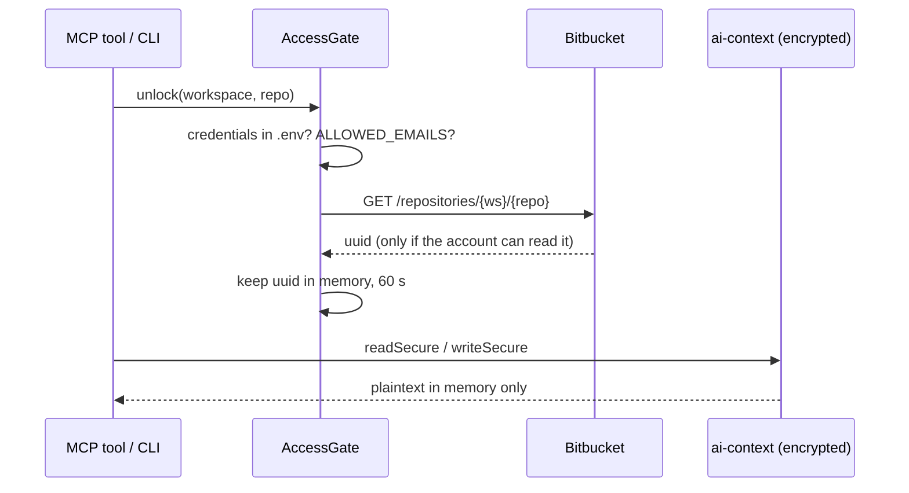

# ai-context encryption

Everything this project stores under `ai-context/` is encrypted. Opening the folder in an editor, a file browser or another tool shows only a short header and binary data. The content can be read only through this project's MCP tools or CLI, and only after a live Bitbucket check succeeds with the credentials in `.env`.

## 1. What it protects, and what it does not

| Protected | Not protected |
|---|---|
| Browsing `ai-context/` by hand or with file tools, indexers or other agents | Someone who has the repository UUID (see §6) and a copy of the files |
| A copied or backed-up `ai-context/` folder on a machine without working credentials | Text returned by the tools: agents receive plaintext, and so does the LLM provider behind them |
| Tampering: any changed byte makes the file unreadable instead of silently wrong | `Logs/` (redacted, not encrypted) and `.env` itself |

**Still visible in plaintext:** folder and file names (workspace, repository slug, PR status, PR number, file ids such as `file_0003`, revision ids built from commit hashes) and each file's header (`workspace`, `repo`, `pr`, salt).

The canonical path is `ai-context/[<AI_CONTEXT_COMPANY>/]<workspace>/<repo>/<open|draft|merged|declined>/pr_<id>/`. The directory records the state at the last successful sync. Bitbucket draft PRs have state `OPEN` and are stored under `draft`; `open` contains only non-draft PRs. There is no `all` directory. During migration, readers also search the previous status-less layout and legacy roots.

## 2. File format (`src/core/storage/secure-file.ts`)

```
"PRC1\n"                                   magic, 5 bytes
{"v":1,"workspace":…,"repo":…,"pr":…,"salt":…}\n   header, plaintext JSON line
iv (12 bytes) ‖ AES-256-GCM ciphertext ‖ tag (16 bytes)
```

- **Key:** `HKDF-SHA256(ikm = repository UUID, salt = 16 random bytes per file, info = "mcp-pr-companion/ai-context/v1", 32 bytes)`.
- **AAD:** the whole header line. Editing the header (for example to move a file to another PR) makes decryption fail.
- **Tag:** exactly 16 bytes (`authTagLength: 16`); short or truncated files are rejected.
- **Errors:** every decryption failure reads `Cannot decrypt: no access to this repository or the file was modified.` A file without the magic raises `PlaintextFileError`; it was written before encryption existed (§7).
- **Writes:** temp file, fsync, then rename (`AtomicWriter`), so a crash never leaves a half-written file.
- **Frozen:** `PRC1` and the info string are part of every existing file. Never change them, or all existing data becomes unreadable.

## 3. Where the key comes from, and why

The key material is the **repository UUID**. Bitbucket returns it from `GET /2.0/repositories/{workspace}/{repo}` only to an account that can read the repository. So whoever can read the repository on Bitbucket can read its local context, and nobody else can.

- Rotating the API token does not lose data: the UUID does not change.
- No key is stored anywhere: the UUID lives in memory only.
- The design mirrors `mcp-server-logs`, which uses the OpenObserve organization identifier the same way.

## 4. The access gate (`src/core/auth/access-gate.ts`)



- `unlock()` fails with `No access: …`:
  - **credentials missing**, or **`ALLOWED_EMAILS` denies** the account;
  - **HTTP 401**: invalid credentials;
  - **HTTP 403 / 404**: `No access: this account cannot read <ws>/<repo>`;
  - **network error**: `No access: cannot connect to Bitbucket (…)`.
- A successful check is cached for **60 s** per repository (`AccessGate.TTL_MS`), so a burst of tool calls costs one request.
- Readers and writers are synchronous and call `AccessGate.material()`, which throws `No access: … is locked` if nobody unlocked the repository. Every entry point unlocks first: all MCP tools, `GenerationJob` (CLI generate) and the CLI viewer.
- **Offline means no access.** Cached data cannot be read without a successful check. This is deliberate.

## 5. Reading the data

| Who | How |
|---|---|
| AI agent (direct or via mcp-hub) | The MCP tools (`get_pr_context_pack`, `search_pr_files`, `get_pr_file_context`, …). Never open `ai-context/` files directly. |
| Developer | `node bin/cli.js cmd` → log in → **View synced PR context (decrypted)**. It picks a synced PR and prints `context.md` or one file's detail. |

Plaintext is printed or returned and never written back to disk. `list_synced_prs` lists local revisions by status after unlocking their repositories.

When a PR changes state or draft status, the next successful sync writes and validates the new encrypted revision first, then migrates retained revision directories from legacy or stale status paths into the canonical status directory. Same-volume moves rename revision directories after their encrypted files are verified. Across volumes, the writer copies each file through `readSecure` and `writeSecure` into destination-side staging, then compares the decrypted contents before publishing the copy. It preserves revision directory modification times so retention keeps the same history. When the old and new active revisions have the same ID, the freshly validated revision replaces the old copy. The PRC1 format and HKDF info string remain unchanged. A migration failure or destination conflict leaves the source readable. The sync pipeline checks for leftover legacy or status directories even when commits and state are unchanged, so the next ordinary CLI or MCP sync retries migration; an unresolved conflicting history remains available in the source until the destination is repaired. Readers can find history in either location while migration is pending. Historical revisions remain subject to the five-revision retention limit.

## 6. Limits

- **The UUID is the secret.** Anyone who has ever seen the repository UUID (any account that once had read access, an API response, a webhook payload) can decrypt copies made with it, even after their access is removed. Removing a person's repository access stops this tool from unlocking for them, but not a copy plus the UUID.
- The gate is enforced in this project's code. A modified copy of the code with a valid token can unlock any repository that token can read.
- Encryption covers data at rest only. What the tools return reaches the agent and its LLM in plaintext, after the usual sanitization (secrets, emails, paths).

## 7. Migrating data written before encryption

Pre-encryption files have no `PRC1` magic. The reader treats them as "not synced", so the next sync of a PR rewrites it encrypted and prunes the old plaintext revisions. To remove all plaintext at once:

```bash
node bin/cli.js purge-plaintext   # deletes every non-PRC1 file under ai-context/, no network needed
```

Then sync again (`sync_my_open_prs`, the CLI, or `AUTO_SYNC_ON_START=true`).

## 8. Tests

- `tests/secure-file.test.ts`:
  - round trip;
  - the bytes contain neither content nor UUID;
  - the header is readable without a key;
  - wrong key, flipped bit, edited header and truncation are all rejected;
  - plaintext detection and `purge-plaintext`.
- `tests/server.test.ts` §9a:
  - every file of a synced PR is encrypted and leaks nothing;
  - without repository access, every read tool answers `No access`.
